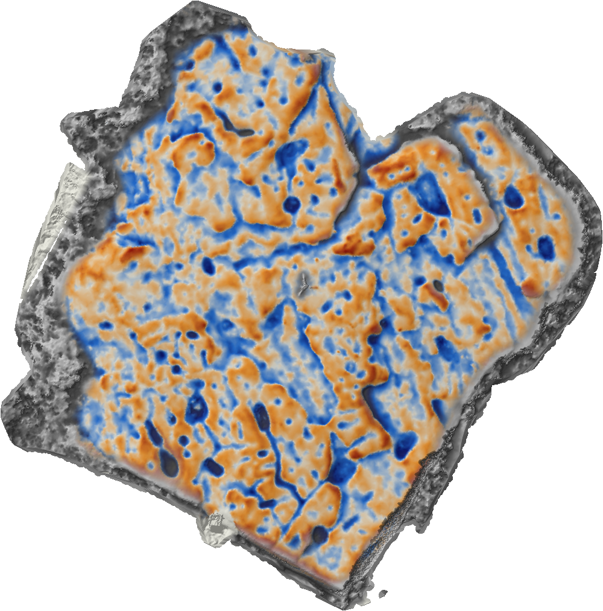

# Cupstone colorizer

Colors each vertex of a stone scan in mesh (.obj) format by its local relief (hollows blue, ridges orange), so cups and engravings stand out.

This has been inspired by Bratke et al. (2025), but tries to automate the process further for stones where a convex hull as a reference surface cannot be easily generated (e.g. because of obstacles in the scan or a complex geometry).

Code written with Claude Opus 5.5.

```
pip install numpy scipy
python colorize_stone.py Nr38.obj Nr38_colored.obj --scale 0.15 --fine 0.02 --level
```

- `--scale`: largest feature size to highlight, in mesh units (Nr38 looks like metres). Bigger values pick up larger cups and broad grooves; smaller values focus on small cups and fine lines. Default: 1.2% of the mesh diagonal.
- `--fine`: features smaller than this are smoothed away (natural roughness). 0 keeps all detail.
- `--cmap`: `diverging` (default), `hollows` (only depressions colored), `gray`.
- `--clip`, `--gamma`: contrast stretch; lower gamma boosts faint features.
- `--terrain`: grays out rough terrain (grass, gravel) and leaves it out of the contrast stretch. `auto` (default) finds the roughness threshold itself; `off` colors everything; a number sets the threshold in mesh units.
- `--level`: rotate the output so the stone lies flat. The coloring itself does not depend on orientation.
- `--export-smoothed PATH.obj`: also write the smoothed reference surface (smoothed at `--scale`) that the relief is measured against, with the same vertex colors and the same `--level` rotation, so it can be overlaid on the colored output in MeshLab. With `--fine`, the fine-smoothed surface is written as `PATH_fine.obj` too (the relief is the distance between the two).

The output .obj drops the texture reference so MeshLab shows vertex colors.

`preview_top.py colored.obj out.png [width]` renders a quick top view (needs pillow; expects a levelled mesh).

Example output:


This image shows stone "38" at the [Pfitscher Sattel](https://www.rgroeber.de/pfitscher_schalensteine.html) site in South Tyrol. 

## Literature

Bratke, M., Kersten, T., Lindstaedt, M., & Nösler, D. (2025). 3D-Erfassung von Schalensteinen im Landkreis Stade durch SfM-Photogrammetrie und ihre Visualisierung in Cesium. Publikationen der DGPF, Band 34, 2026.